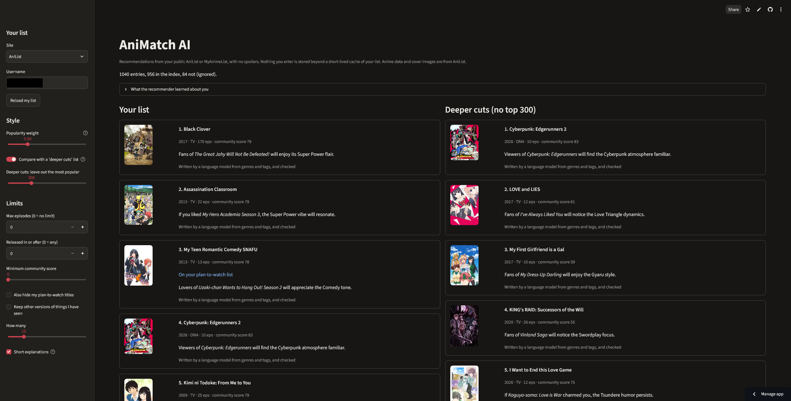

# AniMatch AI

A spoiler-free anime recommender. Give it your public AniList or MyAnimeList username and it
suggests shows you have not seen, with the titles you liked that led to each pick.

**Live demo:** [https://animatch-ai.streamlit.app/]



I built it to learn how to evaluate a recommender honestly, not only to make one. The main result
is mixed, and this page says so.

## What it does

- Reads a public watchlist from AniList or MyAnimeList (official API, no login).
- Builds a taste profile from ratings, falling back to completed, watching and dropped status for
  the many titles people never rate. Unrated titles count, but with a cap, so hundreds of them
  cannot outvote a few deliberate high ratings.
- Hides everything you have already seen, counting a whole franchise as seen (all seasons, movies
  and OVAs), plus other versions of the same story.
- Ranks the rest by taste and shows each pick at its first entry, with the liked titles that
  explain it.
- Optionally writes one short sentence per pick with a language model, checked against the facts it was given (below).
- Shows no synopsis and no spoiler-flagged tags. Filters: episode count, release year, community
  score.

## How it works

1. **Data.** The 5,000 most popular anime on AniList (TV, movie, ONA, OVA; adult titles excluded).
   4,869 have a synopsis and a release, and are grouped into 3,013 franchises from AniList's
   relation links.
2. **Vectors.** Each title is embedded (all-MiniLM-L6-v2) from its genres, non-spoiler tags and
   synopsis, and stored in ChromaDB. A second representation is an IDF-weighted genre and tag
   vector.
3. **Taste and scoring.** The method that ships is `minilm@center=1@knn=10@genre=1@pop=0.5@qual=2`:
   embeddings with the shared "typical anime" component removed, scored against the 10 nearest
   liked franchises, fused with the tag score, plus a popularity prior and a community-score prior.
   Both weights are sliders on the page.
4. **Deeper cuts.** A toggle shows a second list with the most popular franchises left out.

## How I evaluated it

A recommender cannot be judged by eye on one profile, and my first attempts showed why: the first
version looked reasonable on my own list and scored almost no better than random.

**Test.** For each user, hide one franchise they rated 8 or higher, build the recommendation from
the rest, and see where the hidden franchise ranks among everything they have not seen. Recall@10 is
the share of hidden franchises that land in the top 10, averaged per user, with 95% intervals from
resampling users. Baselines: random, popularity, and a genre/tag vector.

**Users.** Three separate sets of 25 public AniList users, sampled from the recent-activity feed and
stored as ids and scores only. I compared methods on the first set (development). For each later
change I wrote down one configuration and a success rule first, committed it, then ran a set of
users that had not been used to choose it, once.

**Three views.** Popularity alone is a very strong baseline, because the hidden title is something
the user chose to watch and people mostly watch popular things. So I report the full catalog and
two views with the 300 or 1,000 most popular franchises removed, which asks whether the system finds
less obvious titles.

**Round 1** (second set of users): the first configuration, without a quality term. The result was
partial: clearly better than popularity with the 1,000 most popular titles removed (+9.8 pts), not
clearly different with the top 300 removed (+4.0 pts, interval -0.3 to +8.5), and not clearly different
on the full catalog (-1.9 pts, interval -9.1 to +5.2; 13.3% against 15.2% for popularity). The same
configuration was clearly worse than popularity on the full catalog on the third set of users.

**Round 2** (third set of users): I added a community-score term (my own list had shown low-scored
picks), tuned its weight on the development users and committed the choice and the rule. Recall@10:

| View | Popularity | Community score alone | Round 1 configuration | Current (with quality term) |
|---|---|---|---|---|
| Top 1,000 removed (194 hidden) | 1.8% | 11.6% | 10.9% | 17.0% |
| Top 300 removed (404 hidden) | 4.5% | 3.0% | 6.9% | 10.8% |
| All franchises (500 hidden) | 15.8% | 8.2% | 8.4% | 15.8% |

Paired against the Round 1 configuration the current one is clearly better with the top 300 removed
(+3.9 pts [+0.7, +7.8]) and on all franchises (+7.4 pts [+4.2, +10.8]), and not clearly different with
the top 1,000 removed (+6.1 pts [-5.9, +19.0]), which met the adoption rule. Against popularity it is
a tie on the full catalog (+0.0 pts [-4.2, +3.8]) and clearly better with the top 300
(+6.3 pts) or the top 1,000 (+15.2 pts) removed. It is clearly better than community score alone in
two of the three views.

**What I learned**
- Text embeddings compared directly were about as good as random until I centered the vectors, and
  worse than random once popular titles were removed. Centering, a popularity prior and a quality prior
  mattered more than the choice of embedding model.
- Scoring by the nearest few liked titles looked best on one setting of K and poor on others. I did
  not trust the best of a dozen settings, and picked the configuration that held up in both tail
  views instead.
- The genre/tag vector alone was better than popularity when the 1,000 most popular titles were
  removed and clearly worse on the full catalog.
- Community score alone is a strong baseline once the very popular titles are removed: with the top
  1,000 removed it did as well as my first configuration.
- Retellings slipped through as "unseen": a 2012 OVA of a story I had just watched was recommended
  first, because AniList links them only as `ALTERNATIVE`. They are now hidden, which the evaluation
  above did not include.

## Limits

- The test measures finding things you already watched and loved, not whether a new recommendation
  would be enjoyed. It favors popular and well-reviewed titles. It is a proxy for comparing versions.
- 25 users sampled from an activity feed favor people who update often. The tail views rest on a few
  hundred hidden titles, and some users contribute one or two.
- The community-score term is rewarded by how the test is built: the hidden title is one the user rated
  highly, and community score predicts personal ratings. The test does not show that the picks are more
  enjoyable or more novel. With the quality weight at 0, low-scored titles can appear.
- Only the top 5,000 titles, no shorts or specials, and no adult titles. About 8% of my own list's
  entries were not in the index.
- Related titles linked only as `OTHER`, and TV side stories, count as separate franchises, so a
  sequel can be recommended to someone who liked the first series.
- The optional one-sentence explanations are checked for what they name, not for tone or usefulness, and a spoiler that is not in my spoiler-tag list would pass. They go through a free hosted model, so the hosted page will often fall back to a plain template.

## Explanations

Each pick can get one sentence saying why it fits, written by a language model. The model is given
only the pick's genres and tags and the ones it shares with your liked titles, never a synopsis or
a spoiler-flagged tag, and must mark every title and attribute it uses so code can check them.
A sentence that names a title or attribute that was not supplied, mentions another title, includes
a spoiler-flagged tag or uses a stray number is thrown away and replaced by a plain template built
from the same facts. Nothing unchecked is shown.

On 10 development users (100 picks), 98 sentences passed the check on the final run. The two that
failed were a sentence containing a spoiler-flagged term, which the model produced from its own
knowledge of the show, and one with an attribute that was not in the supplied list. The check limits what can be
claimed, not whether the sentence is good, and it only knows the spoiler terms in my list.
`python src/eval_explanations.py --users-dir data/eval_users` reproduces the measurement
(needs an `LLM_API_KEY`).

## Run it

The deployed bundle is committed, so the page runs from a clean checkout:

```
pip install -r requirements.txt
streamlit run app.py
```

Command line, and the whole pipeline (needs `requirements-dev.txt`):

```
python src/recommend.py anilist <username> --skip-popular 300
python src/fetch_anilist.py --pages 100    # crawl
python src/franchise.py                    # group into franchises
python src/build_index.py                  # embed into ChromaDB
python src/export_runtime.py               # write app_data/ for the page
python src/evaluate.py --methods popularity quality minilm@center=1@knn=10@genre=1@pop=0.5@qual=2
pytest
```

Explanations need `LLM_API_KEY` (any OpenAI-compatible provider; the default is Groq's free tier). MyAnimeList lists need a free client ID in `MAL_CLIENT_ID` (environment or `.env`; a Streamlit
secret when hosted). AniList needs no key.

## Data and privacy

Anime data and cover images come from AniList. A watchlist is cached briefly so the page does not
refetch it, and nothing is logged. The evaluation users are anonymous ids and scores, kept out of
the repository, and the results files contain aggregate numbers only. AniList's terms prohibit mass
collection, so the user sample is small on purpose.

## More

- [NOTES.md](NOTES.md): a dated log of what I did, what failed and what surprised me.
- [DECISIONS.md](DECISIONS.md): each design choice with its reason and cost, including the
  evaluation protocol and the success rule written before the test run.
- `results/`: the evaluation outputs.
